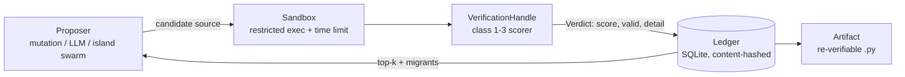

# Touchstone

**A small generate → verify → artifact engine: a proposer (an LLM, or anything) writes candidate programs; an external, deterministic scorer decides what counts.**

The proposer never has to be right. Every candidate is screened and run in a restricted sandbox that cannot reach the scorer through any route we know of, and is scored by a separate, deterministic `VerificationHandle`; only scored results are kept, deduplicated in a ledger, and written out as artifacts you can re-verify later. Pointing the engine at a new domain means writing one new handle.

## Why it is interesting

LLMs produce plausible-but-wrong output at a steady rate. The FunSearch / AlphaEvolve pattern sidesteps that: let the model propose freely and put all of the trust in the evaluator. Touchstone is a compact, readable implementation of that pattern with three ideas made explicit:

1. **Verifiers are ranked by how much you can trust them.** Each handle declares a verification class:

   | class | what "verified" means | example in this repo |
   |---|---|---|
   | 1 exact | machine-checked proof of a property | `apfree`: exhaustive check that a set has no 3-term arithmetic progression |
   | 2 simulation | the score *is* the objective | `bin_packing`, `binpack_trimodal`: bins actually used |
   | 3 held-out fit | predicts data it never saw | `symbolic_regression`, `lightcurve` |
   | 4-6 | reproducible anomaly / lab experiment | not implemented; the honest output there is a ranked candidate list, not a "discovery" |

2. **"Fits held-out data" is not "true", so verifiers compose.** `RobustSymRegHandle` combines interpolation R², out-of-range extrapolation R² and an AST description-length penalty. A degree-9 polynomial passes plain held-out R² (0.991) and is rejected on extrapolation (R² ≈ −19,000); the true 4-parameter law is accepted (`examples/02`).

3. **Results are artifacts, not log lines.** Every reported result in this README is a program in `artifacts/` that `examples/reverify_artifacts.py` re-scores from scratch, offline, each in a fresh interpreter. One historical result did *not* survive that re-check, and it is reported as such below.

## Architecture



```
touchstone/
  core/verifier.py      VerificationHandle ABC, Verdict, VerifierRegistry
  core/sandbox.py       static token + AST screen, restricted exec, `math`-only imports, SIGALRM time limit
  core/isolate.py       verify one candidate in a freshly spawned interpreter
  core/ledger.py        SQLite candidate store, dedup by content hash, provenance
  core/evolve.py        (mu + lambda) loop for parameter genomes
  core/complexity.py    AST description-length (parsimony) score
  problems/             one module per domain: a handle + prompt + seeds
  proposers/mutation.py no-LLM proposer (proves the plumbing)
  proposers/llm.py      code-writing proposer; anthropic | openai | command backends
  proposers/swarm.py    parallel island swarm with ring migration, mixed model families
examples/               three runnable examples + artifact re-verification
artifacts/              result programs + manifest of what each must reproduce
```

The sandbox screens source before running it (no dunder or underscore attributes, no frame / code / generator / traceback attributes such as `gi_frame` or `f_globals`, no `str.format`, no attribute assignment, no async code), then runs it with whitelisted builtins, only `math` importable, and a wall-clock limit. Tests pin the known escapes, including a frame walk that reads a file and one that patches the verifier's globals to fake an AP-free proof. It is still in-process restriction of CPython, which is not a proven security boundary, and there is no memory cap. Search loops verify in-process for speed; shipped results are re-verified in a fresh process (`core/isolate.py`). Run untrusted proposers inside a container.

## Quickstart

```bash
git clone https://github.com/nmcbride-42/touchstone && cd touchstone
python -m venv .venv && . .venv/bin/activate
pip install -e ".[dev]"

pytest                                         # offline; ~20 s
python examples/reverify_artifacts.py          # re-score every result below
python examples/01_spine_mutation.py           # the loop with no LLM
python examples/02_discriminating_verifier.py  # robust vs naive verifier
```

With an LLM (makes real, paid calls):

```bash
pip install -e ".[anthropic,openai]"
cp .env.example .env          # fill in keys and models
set -a; . ./.env; set +a
python examples/03_island_swarm.py --problem apfree --generations 2 --per-gen 2
python examples/02_discriminating_verifier.py --llm 3
```

### Configuration

All configuration is environment variables (`touchstone/config.py`, `.env.example`):

| variable | default | purpose |
|---|---|---|
| `TOUCHSTONE_LLM_PROVIDER` | `anthropic` | backend for single-proposer runs: `anthropic`, `openai`, `command` |
| `TOUCHSTONE_SWARM` | `anthropic,anthropic` | one provider per island for `examples/03` |
| `ANTHROPIC_API_KEY` | | read by the `anthropic` SDK |
| `TOUCHSTONE_ANTHROPIC_MODEL` | `claude-opus-5-5` | Claude model id |
| `TOUCHSTONE_ANTHROPIC_EFFORT` | `medium` | `output_config.effort` |
| `TOUCHSTONE_ANTHROPIC_FALLBACKS` | `default` | server-side refusal fallback (beta); `off` to disable |
| `OPENAI_API_KEY` | | read by the `openai` SDK |
| `TOUCHSTONE_OPENAI_MODEL` | (required) | model id for the openai backend |
| `TOUCHSTONE_OPENAI_BASE_URL` | OpenAI | any OpenAI-compatible server (vLLM, llama.cpp, Ollama, ...) |
| `TOUCHSTONE_OPENAI_TEMPERATURE` | unset | optional sampling temperature |
| `TOUCHSTONE_LLM_COMMAND` | | `command` backend: a CLI that reads the prompt on stdin |
| `TOUCHSTONE_LLM_TIMEOUT` | `300` | per-call timeout, seconds |
| `TOUCHSTONE_DATA_DIR` | `./data` | cached light curves |
| `TOUCHSTONE_OUTPUT_DIR` | `./runs` | ledgers, trajectories and artifacts from example runs |
| `TOUCHSTONE_RUN_NETWORK_TESTS` | `0` | `1` runs the one live-LLM test |

## What is measured, and how

Every row is reproduced by `python examples/reverify_artifacts.py` from the program in `artifacts/`, one fresh interpreter per artifact. The *search* that found each program was a historical run with a small budget (noted per row); re-running the search with an LLM is stochastic and will not necessarily find the same program.

| problem (class) | result, re-verified | baseline, same scorer | search budget (historical) |
|---|---|---|---|
| 3-AP-free subset of {0..999} (1) | **size 111**, exhaustively proven AP-free | base-3 construction: 105; powers of two: 10 | 4-island swarm, 2 generations; 8 LLM-written candidates |
| 3-AP-free subset of {0..999} (1) | size 105 (LLM rediscovered the base-3 construction) | powers of two: 10 | a few batched calls |
| Online bin packing, trimodal trap distribution (2) | **9.87% train / 9.57% held-out** mean excess bins | best-fit 10.87% / 10.35%; first-fit 11.09% / 10.33% | 4-island swarm, 2 generations; 14 LLM-written candidates |
| Symbolic regression, hidden damped oscillation (3) | held-out **R² 0.983** | best of linear and cubic: −0.18 | won in generation 1 |
| EB light curve, TIC 329089161 (3) | 4-param two-Gaussian model: held-out R² 0.964 | single primary dip: 0.765 | small single-model run |
| EB light curve, same star (3) | 7-param sech² model: held-out R² 0.944 | single primary dip: 0.765 | 2 islands, 3 generations |

How to read these honestly:

- **AP-free, 111.** Correctness is exact; the size is what it is. It beats the classic base-3 construction at N = 1000, but it is not a record claim: we did not compare against the best-known lower bounds for r₃(1000) from dedicated computational searches. In that run the GPT islands returned no parseable code, so all candidates came from the Claude islands.
- **Bin packing.** The distribution was designed so that best-fit falls into dead space, and the prompt told the model the item modes and the mechanism. The win (about 1 percentage point of excess: 0.45 fewer bins per ~46-bin instance on train, 0.35 on held-out) is real on held-out instances from a different seed, but it is a heuristic tuned to this generator, not a better general bin-packing rule. On the uniform-ish benchmark in `problems/bin_packing.py`, best-fit is near-optimal and nothing beat it; that negative result is documented in the module.
- **Symbolic regression.** Recovering a known law from 14 noisy points, verified on held-out points. A demonstration of the loop, not a discovery.
- **Light curve, and a result that did not hold up.** On an earlier fetch of this star's TESS light curve, the 7-parameter sech² model scored 0.970 and beat the 4-parameter Gaussian model (0.958). The curve shipped here was re-fetched with more TESS sectors; on it the ranking reverses (0.944 vs 0.964). Both programs are kept, and the manifest asserts the current numbers. Adjacent phase bins are correlated, so a random split of 140 bins makes held-out R² optimistic.
- **Not included.** An earlier experiment fit L = a·Rᵇ·Tᶜ to catalogued radius, temperature and luminosity of 10 stars and recovered exponents near 2 and 4 (Stefan-Boltzmann). The catalog derives L from R and T, so the law is baked into the data, and the data came from a private pipeline. Mentioned for completeness; not reproducible from this repo and not counted as a result.

## Examples

| file | needs an LLM | what it shows |
|---|---|---|
| `examples/01_spine_mutation.py` | no | the loop end to end with a blind mutation proposer over a 3-parameter heuristic family; it matches best-fit, which is the family's ceiling. It exercises the plumbing, not search power. |
| `examples/02_discriminating_verifier.py` | optional (`--llm N`) | interpolation + extrapolation + parsimony rejects an overfit that plain held-out R² accepts |
| `examples/03_island_swarm.py` | yes | parallel islands with per-island strategy hints and optionally different model families, ring migration, ledger + trajectory + artifact output; `--problem apfree / binpack / lightcurve / symreg` |
| `examples/reverify_artifacts.py` | no | re-scores every artifact against `artifacts/manifest.json` |

Adding a domain: subclass `VerificationHandle` with a deterministic `verify(candidate) -> Verdict`, add a system prompt, a `build_prompt(examples, n)` and seed programs, and register it in `examples/03`.

## Status

**Research prototype.** The engine, sandbox, verifiers and tests are small and stable; the results are modest demonstrations at small search budgets (tens of candidates, not FunSearch's millions). Not done: formal-proof (Lean/SMT) handles for class 1, per-candidate process isolation inside the search loop (only re-verification is isolated), memory limits, and any class 4-6 handle.

## Tests

`pytest` runs 61 offline tests: sandbox escapes (frame walks, `str.format` attribute paths, module patching) and time limits, isolated re-verification, each verifier against known-good and known-bad candidates (including a brute-force cross-check of the AP-free checker), ledger dedup, the mutation loop, the island swarm with scripted proposers (best tracking, migration, stop score), the LLM response parser and the `command` backend, and re-verification of every artifact. One test that makes a live LLM call is skipped unless `TOUCHSTONE_RUN_NETWORK_TESTS=1`.

## Data

`data/lc_329089161.npz` (4 KB): the phase-folded, binned TESS 2-minute light curve of TIC 329089161, built from public MAST data with `touchstone/tools/fetch_lightcurve.py` (needs `pip install -e ".[fetch]"`).

## How it was built

Designed by Nick McBride and built with his AI agent Iris (Claude-based) as part of a personal research platform.

## License

MIT. See [LICENSE](LICENSE).
